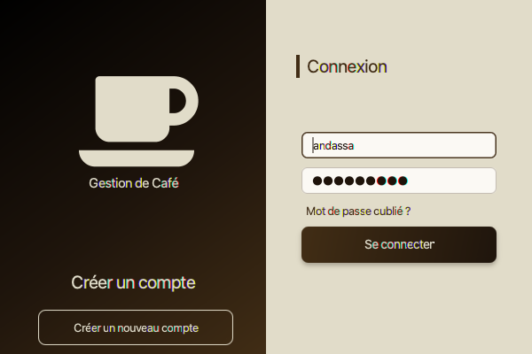
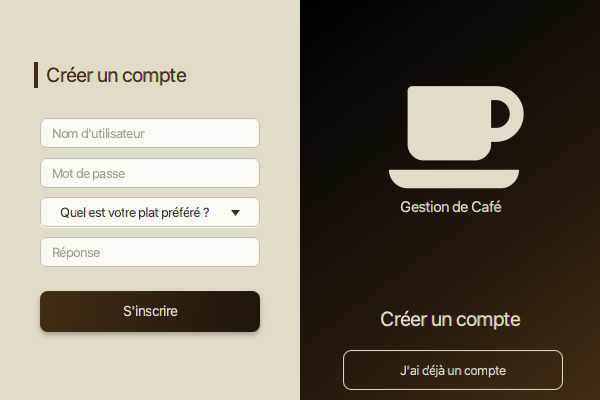
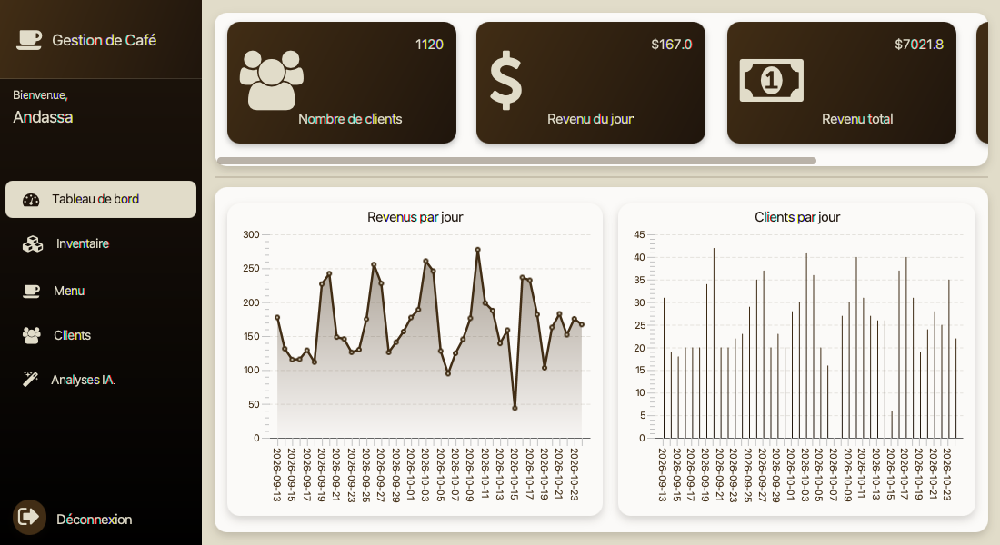
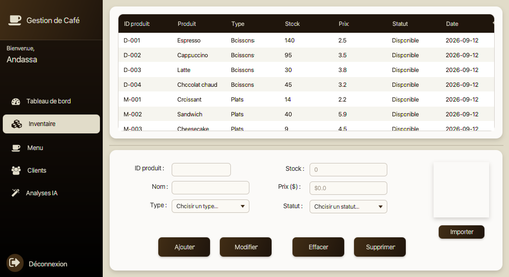
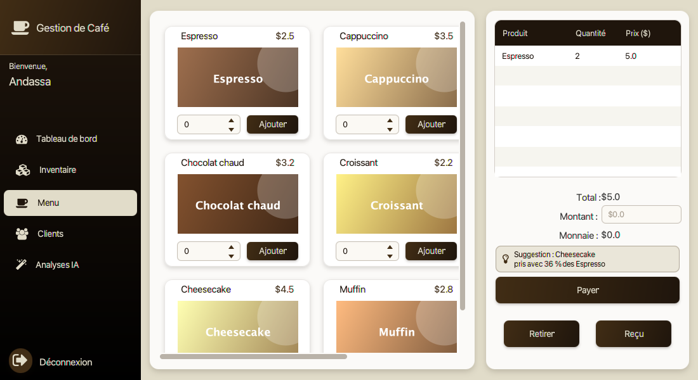
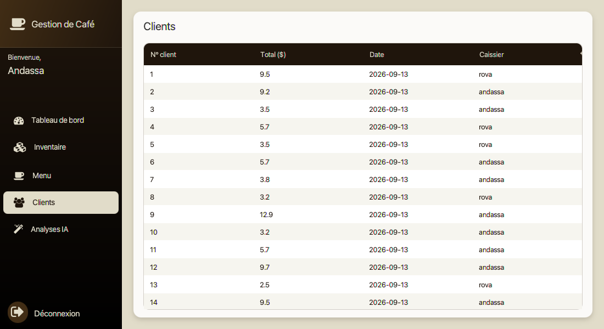
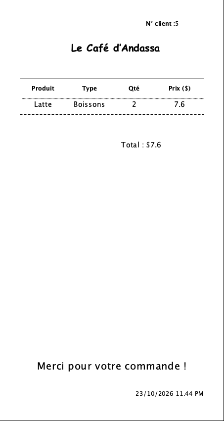
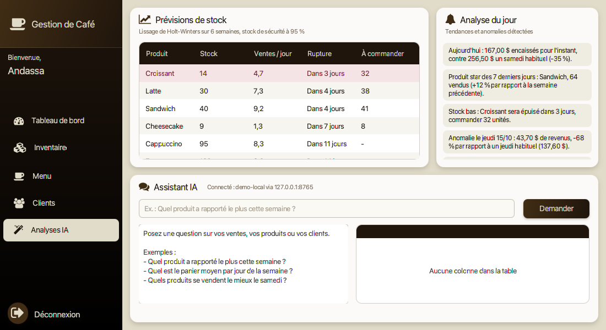
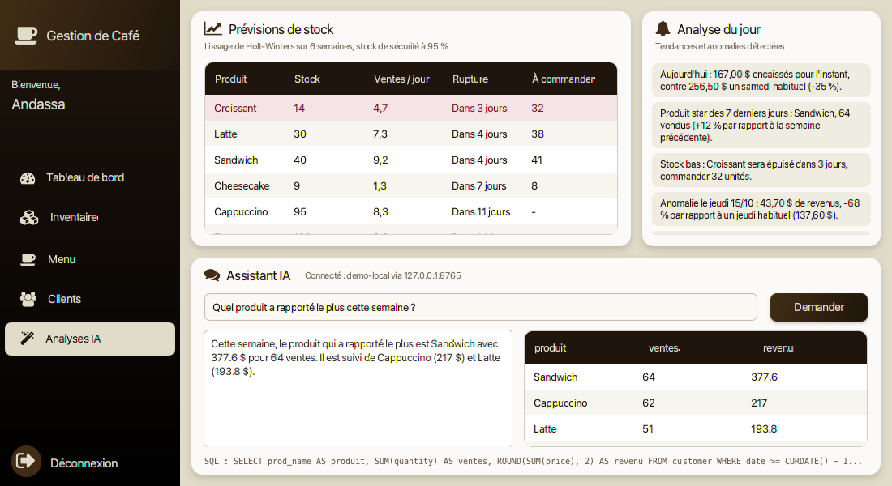

# CafeShopManagement

Application de bureau de **gestion de café** développée en **JavaFX** avec une base de données **MySQL**.
Elle permet de gérer les employés, le stock de produits, la prise de commandes, les paiements et l'édition de reçus,
avec des **analyses IA** gratuites : prévision de stock, suggestions de produits, détection d'anomalies et assistant en langage naturel.

[](https://github.com/Andassa/CafeShopManagement/actions/workflows/ci.yml)
[](https://github.com/Andassa/CafeShopManagement/actions/workflows/security.yml)


---

## Aperçu

| Connexion | Inscription |
|-----------|-------------|
|  |  |

| Tableau de bord |
|-----------------|
|  |

| Inventaire | Menu et commandes |
|------------|-------------------|
|  |  |

| Clients | Reçu |
|---------|------|
|  |  |

| Analyses IA | Assistant IA |
|-------------|--------------|
|  |  |

---

## Sommaire

- [Aperçu](#aperçu)
- [Fonctionnalités](#fonctionnalités)
- [Intelligence artificielle](#intelligence-artificielle)
- [Technologies](#technologies)
- [Structure du projet](#structure-du-projet)
- [Base de données](#base-de-données)
- [Installation et lancement](#installation-et-lancement)
- [CI/CD et DevSecOps](#cicd-et-devsecops)
- [Auteur](#auteur)

---

## Fonctionnalités

### Interface
- Entièrement en **français** (écrans, messages et reçu)
- Palette **café** : `#000000` noir, `#1F150C` brun nuit, `#412D15` café, `#E1DCC9` beige
- Navigation avec icônes et onglet actif, cartes arrondies, graphiques épurés

### Authentification
- Connexion des employés (nom d'utilisateur / mot de passe)
- Création de compte avec **question de sécurité**
- Réinitialisation du mot de passe via la question de sécurité

### Tableau de bord
- Nombre total de clients
- Revenu du jour et revenu total
- Nombre de produits vendus
- Graphiques d'évolution des **revenus** et des **clients** par date

### Inventaire
- Ajout, modification, suppression de produits
- Catégories : Plats / Boissons
- Statut : Disponible / Indisponible
- Gestion du stock et import d'une image par produit

### Menu & commandes
- Affichage des produits sous forme de **cartes**
- Ajout au panier avec choix de la quantité (le stock est décrémenté automatiquement)
- Calcul du total, saisie du montant payé et rendu de monnaie
- Paiement et génération d'un **reçu** imprimable (JasperReports)

### Clients
- Historique des commandes / reçus (ID client, total, date, caissier)

### Analyses IA
- Prévision de stock et quantités à commander
- Suggestion de produit pendant la prise de commande
- Analyse du jour : tendances, anomalies, produits en perte de vitesse
- Assistant : questions en français sur les données du café

---

## Intelligence artificielle

Toutes les fonctionnalités sont **gratuites**. Les trois premières sont calculées localement, sans service externe ni dépendance supplémentaire.

| Fonctionnalité | Méthode | Où |
|----------------|---------|----|
| **Prévision de stock** | Lissage de **Holt-Winters** additif (niveau, tendance, saisonnalité hebdomadaire) sur 6 semaines. La date de rupture est estimée par cumul des ventes prévues, et la quantité à commander couvre 7 jours avec un **stock de sécurité** à 95 % (1,65 × écart-type des erreurs × √7). | Analyses IA |
| **Suggestions** | **Règles d'association** (analyse de panier) : confiance P(B \| A) et lift calculés sur toutes les commandes payées. Seules les règles avec un lift supérieur à 1,1 sont proposées. | Menu |
| **Anomalies** | Chaque jour est comparé aux 4 mêmes jours de la semaine précédents avec la **médiane et l'écart absolu médian** (score z robuste, seuil 3). Un produit qui se vendait mais plus du tout depuis 7 jours est aussi signalé. | Analyses IA |
| **Assistant** | Un modèle de langage traduit la question en SQL, l'application l'exécute, puis le modèle rédige la réponse à partir du résultat. | Analyses IA |

### Sécurité de l'assistant

La requête générée par le modèle n'est jamais exécutée telle quelle :

- une seule requête `SELECT` ou `WITH`, sans commentaire ni point-virgule ;
- mots-clés d'écriture et fonctions dangereuses refusés (`INSERT`, `DROP`, `INTO OUTFILE`, `SLEEP`...) ;
- accès interdit à la table `employee` (mots de passe) et aux schémas système ;
- connexion en **lecture seule**, délai maximal de 5 secondes, 200 lignes maximum ;
- la clé d'API est lue dans une variable d'environnement, jamais dans le code (vérifié par Gitleaks).

Ces règles sont couvertes par les tests unitaires (`tests/`), lancés à chaque push par la CI.

### Activer l'assistant (gratuit)

L'assistant fonctionne avec tout fournisseur compatible avec l'API OpenAI. Sans configuration, le reste de l'application fonctionne normalement.

| Fournisseur | Configuration |
|-------------|---------------|
| **Groq** (par défaut) | Clé gratuite sur [console.groq.com/keys](https://console.groq.com/keys), puis `export AI_API_KEY=votre_cle` |
| **Google Gemini** | Clé gratuite sur [aistudio.google.com](https://aistudio.google.com/apikey), `AI_BASE_URL=https://generativelanguage.googleapis.com/v1beta/openai` et `AI_MODEL=gemini-2.0-flash` |
| **Ollama** (local, sans clé) | `AI_BASE_URL=http://localhost:11434/v1` et `AI_MODEL=llama3.2` |

### Données de démonstration

Pour tester les analyses, un script génère 6 semaines de ventes réalistes (affluence selon le jour, produits souvent achetés ensemble, une journée anormale, un produit en perte de vitesse) :

```bash
python3 scripts/demo_data.py | mysql -h 127.0.0.1 -u root cafe
```

Attention : le script vide les tables `product`, `customer` et `receipt`. Compte de démonstration : `andassa` / `cafe12345`.

---

## Technologies

| Composant        | Outil                        |
|------------------|------------------------------|
| Langage          | Java 8                       |
| Interface        | JavaFX (FXML + CSS)          |
| Base de données  | MySQL (`mysql-connector-java 5.1.48`) |
| Reçus            | JasperReports 6.3.0          |
| Icônes           | FontAwesomeFX 8.2            |
| IDE / Build      | NetBeans + Ant, script `scripts/build.sh` |
| Conteneurs       | Docker Compose (MySQL 8 + Adminer) |
| CI/CD            | GitHub Actions               |
| Sécurité         | CodeQL, Gitleaks, Trivy, Dependabot |
| IA               | Holt-Winters, règles d'association, score z robuste, LLM compatible OpenAI |

---

## Structure du projet

```
.
├── .github/
│   ├── workflows/
│   │   ├── ci.yml                      # Build, schéma MySQL, Docker Compose
│   │   ├── security.yml                # CodeQL, Gitleaks, Trivy
│   │   └── release.yml                 # Publication des releases sur tag
│   └── dependabot.yml                  # Mises à jour automatiques
├── database/
│   ├── schema.sql                      # Schéma de la base `cafe`
│   └── demo/images/                    # Visuels des produits de démonstration
├── docs/screenshots/                   # Captures d'écran
├── docker-compose.yml                  # MySQL + Adminer
├── .env.example                        # Variables d'environnement
├── scripts/
│   ├── build.sh                        # Build sans NetBeans
│   ├── test.sh                         # Tests unitaires
│   └── demo_data.py                    # Données de démonstration
├── tests/                              # Tests des analyses IA et du garde-fou SQL
└── cafeShopManagementSystem/
    ├── src/cafeshopmanagementsystem/
    │   ├── CafeShopManagementSystem.java   # Point d'entrée de l'application
    │   ├── database.java                   # Connexion MySQL
    │   ├── FXMLDocument.fxml / Controller  # Connexion, inscription, mot de passe oublié
    │   ├── mainForm.fxml / Controller      # Dashboard, inventaire, menu, clients
    │   ├── cardProduct.fxml / Controller   # Carte produit du menu
    │   ├── productData.java                # Modèle produit
    │   ├── customersData.java              # Modèle client / reçu
    │   ├── data.java                       # Données partagées (session)
    │   ├── traduction.java                 # Libellés français des valeurs en base
    │   ├── analyseVentes.java              # Prévisions, suggestions, anomalies
    │   ├── assistantIA.java                # Assistant en langage naturel
    │   ├── aiForm.fxml / Controller        # Écran Analyses IA
    │   ├── report.jrxml                    # Modèle du reçu JasperReports
    │   └── *.css                           # Styles des écrans
    ├── dist/lib/                           # Dépendances (.jar)
    ├── nbproject/                          # Configuration NetBeans
    └── build.xml                           # Script Ant
```

---

## Base de données

Nom de la base : **`cafe`**. Le script complet se trouve dans [`database/schema.sql`](database/schema.sql).

```sql
CREATE DATABASE cafe;
USE cafe;

CREATE TABLE employee (
    id        INT AUTO_INCREMENT PRIMARY KEY,
    username  VARCHAR(100) NOT NULL UNIQUE,
    password  VARCHAR(100) NOT NULL,
    question  VARCHAR(255),
    answer    VARCHAR(255),
    date      DATE
);

CREATE TABLE product (
    id         INT AUTO_INCREMENT PRIMARY KEY,
    prod_id    VARCHAR(100) NOT NULL UNIQUE,
    prod_name  VARCHAR(100) NOT NULL,
    type       VARCHAR(50),
    stock      INT,
    price      DOUBLE,
    status     VARCHAR(50),
    image      VARCHAR(500),
    date       DATE
);

CREATE TABLE customer (
    id           INT AUTO_INCREMENT PRIMARY KEY,
    customer_id  INT,
    prod_id      VARCHAR(100),
    prod_name    VARCHAR(100),
    type         VARCHAR(50),
    quantity     INT,
    price        DOUBLE,
    date         DATE,
    image        VARCHAR(500),
    em_username  VARCHAR(100)
);

CREATE TABLE receipt (
    id           INT AUTO_INCREMENT PRIMARY KEY,
    customer_id  INT,
    total        DOUBLE,
    date         DATE,
    em_username  VARCHAR(100)
);
```

La connexion est configurée par variables d'environnement (valeurs par défaut entre parenthèses) :

| Variable      | Rôle                    | Défaut                                       |
|---------------|-------------------------|----------------------------------------------|
| `DB_URL`      | URL JDBC                | `jdbc:mysql://localhost/cafe?useSSL=false`   |
| `DB_USER`     | Utilisateur MySQL       | `root`                                       |
| `DB_PASSWORD` | Mot de passe MySQL      | *(vide)*                                     |

---

## Installation et lancement

### Prérequis
- **JDK 8** avec JavaFX (ex. Oracle JDK 8, Zulu 8 *FX* ou Liberica JDK 8 *Full*)
- **MySQL** (ou MariaDB / XAMPP), ou bien **Docker**
- **Apache NetBeans** (recommandé)

### Étapes

1. **Cloner le dépôt**
   ```bash
   git clone https://github.com/Andassa/CafeShopManagement.git
   cd CafeShopManagement
   ```

2. **Démarrer la base de données**

   Avec Docker (MySQL + Adminer sur http://localhost:8080) :
   ```bash
   cp .env.example .env
   docker compose up -d
   ```
   Le schéma est appliqué automatiquement au premier démarrage.

   Sans Docker : exécuter `database/schema.sql` sur votre serveur MySQL.

3. **Configurer la connexion** (si différente des valeurs par défaut)
   ```bash
   export $(grep -v '^#' .env | xargs)
   ```

4. **Ouvrir le projet** `cafeShopManagementSystem/` dans NetBeans.

5. **Ajouter les dépendances** : *Project Properties → Libraries → Add JAR/Folder*
   et sélectionner tous les fichiers de `cafeShopManagementSystem/dist/lib/`.

6. **Lancer** l'application avec *Run Project* (F6).

### Build et lancement en ligne de commande

```bash
./scripts/build.sh
java -jar out/package/CafeShopManagement.jar
```

---

## CI/CD et DevSecOps

| Workflow | Déclencheur | Rôle |
|----------|-------------|------|
| **CI** (`ci.yml`) | push / pull request sur `main` | Compilation JDK 8 + JavaFX, packaging du jar (artefact), tests unitaires, application du schéma et des données de démonstration sur un MySQL 8 de test, validation de `docker-compose.yml` |
| **Security** (`security.yml`) | push, pull request, chaque lundi | **CodeQL** (analyse statique du code Java), **Gitleaks** (détection de secrets dans l'historique), **Trivy** (CVE des bibliothèques jar) avec résultats dans l'onglet *Security* |
| **Release** (`release.yml`) | tag `v*` | Build puis publication d'une release GitHub avec l'archive prête à l'emploi (jar + lib + schéma SQL) |
| **Dependabot** | chaque semaine | Mise à jour des actions GitHub et des images Docker |

Publier une nouvelle version :

```bash
git tag v1.0.0
git push origin v1.0.0
```

---

## Auteur

**Andassa** : [github.com/Andassa](https://github.com/Andassa)
